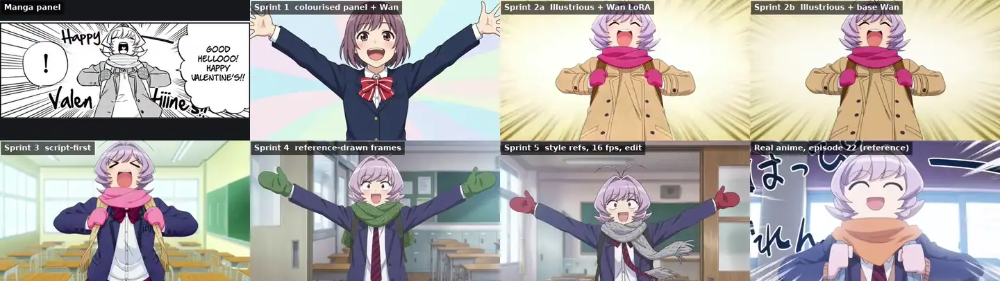
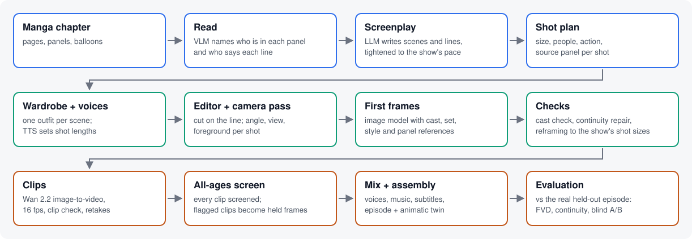

<h1 align="center">MangAnime</h1>
<p align="center"><b>From manga chapters to an anime episode: an open research pipeline, measured against the real adaptation.</b></p>
<p align="center">
  <a href="https://solvai.github.io/MangAnime/">Website and video demos</a> ·
  <a href="eval/README.md">Sprint-by-sprint evaluation</a> ·
  <a href="https://github.com/SolvAI/MangAnime/stargazers">Star the repo</a> ·
  <a href="SUPPORT.md">Support the project</a>
</p>

<p align="center"></p>
<p align="center"><sub>One moment, eight views: the manga panel, six generated versions from sprint 1 to sprint 5, and the shot of the real episode it is measured against. Eleven more in <a href="eval/README.md">eval/</a>.</sub></p>

MangAnime reads manga chapters, writes a screenplay, plans shots, draws first frames, animates them, voices the lines
and assembles a full episode. It was built on one RTX 4090 in a few days of sprints, on a series whose anime exists, so that
every stage can be scored against the real adaptation of the same chapters.
Three episodes of the anime were held out and never used for training, prompting examples or statistics; the generated
episode adapts the chapters of one of them.

It does not replace an animation studio. A blind rater tells the generated episode from the real one every single time.
What it shows is how far a single-GPU pipeline gets, and which stage holds it back at each step.

> Independent fan-made research. Not affiliated with or endorsed by the rights holders of any work it was tested on.
> No episodes, manga, audio or model weights are distributed here. See [NOTICE.md](NOTICE.md).

## Results at a glance

A full 22-minute episode (324 shots) from four held-out manga chapters, compared with the real episode that adapts them.

| | Sprint 1 | Sprint 2b | Sprint 3 | Sprint 4 | **Sprint 5** | Real episode |
|---|---|---|---|---|---|---|
| What changed | colourised panels + Wan 2.2 | Illustrious-XL keyframes | script-first: read, write, plan | frames drawn from reference pictures | show-style references, 16 fps motion, editor pass | |
| FVD against the real episode (lower is closer) | 470 | 326–333 | 346 | 514 | **390** | 321 ¹ |
| Cuts that stay in the same scene ³ | — | 53 % | 76 % | 94 % | **92 %** | 91 % |
| Continuity errors per 100 cuts ³ | — | 7.1 | 10.0 | 1.6 | **2.3** | 1.2 |
| First frames accepted by the cast check | — | — | 157 / 286 | 284 / 286 | **316 / 316** | |
| Mean optical flow (how much moves) | — | — | — | 0.09 | **0.33** | 0.73 |
| Blind A/B, clip against its pan-and-zoom animatic ² | 201 : 86 | 212 : 94 | — | 276 : 9 | **289 : 15** | |

¹ Another real episode against the held-out one: the floor of the metric. ² Automatic vision judge, one vote per shot.
An independent blind rater on 40 pairs preferred the animated clip 28 : 4 in sprint 5.
³ Sprint 2 value measured on sprint 2a, which shares its first frames and shot list with 2b.

**Against the real episode nothing is won yet.** Two independent blind raters picked out the generated side in 160 of
160 judgements and preferred the real frame or clip in about 33 of 40 pairs. Their reasons, in order: stock-looking sets,
costume details that differ from the show, flat frontal staging, no on-screen lettering, heavier line work.
Sprint 6 (in progress) answers the first three: [eval/README.md](eval/README.md#sprint-6-in-progress).

Human rating so far: 6 blind pairs by the author. The raters above are an automatic vision judge and blind AI raters;
the numbers should be read with that in mind.

## How it works

<p align="center"></p>

| Stage | What it does | Model used in the experiments |
|---|---|---|
| Read | Names who is in every panel and who speaks every line, from character cards | Gemini 3.8 Flash |
| Screenplay | Scenes, beats and lines; tightened to the word count of the real series | DeepSeek V4.1 Flash |
| Shot plan | One shot per beat: size, people, action, source panel | DeepSeek V4.1 Flash |
| Wardrobe | One outfit per character per scene, as the show dresses them | DeepSeek + Gemini Flash |
| Voices | English lines; their lengths set the shot lengths | Qwen3-TTS 1.7B |
| Editor pass | Cuts long multi-line shots on a line, to the show's measured rhythm | DeepSeek V4.1 Flash |
| Camera pass | Angle, view and foreground per shot, to the show's measured mix | DeepSeek V4.1 Flash |
| First frames | Drawn from cast pictures, set and style references and the manga panel | Gemini image model, or Illustrious-XL in ComfyUI |
| Frame checks | Cast check, continuity repair between shots, crop to the show's shot sizes | Gemini 3.8 Flash |
| Clips | Image-to-video, 16 fps, with a clip check and retakes | Wan 2.2 I2V 14B (LightX2V) |
| Screen | Every clip screened as all-ages; a flagged clip becomes a held frame | Gemini 3.8 Flash |
| Assembly | Mix, subtitles, the episode and an animatic twin for A/B | ffmpeg |
| Evaluation | FVD, motion, identity, continuity, shot rhythm, voice, blind A/B | see [docs/dev/eval_tools.md](docs/dev/eval_tools.md) |

Things measured on the training episodes and used as targets, never taken from the held-out ones: shot length
distribution (median 3.25 s), shot-size mix, head size per framing, camera angle and view mix, and the look of the
school's rooms.

## What each sprint found

1. **Colourised panels animate, but they are still manga.** Sprint 1 turned each panel into a colour frame and animated
   it. It beat the animatic, and looked nothing like the show (FVD 470).
2. **A video LoRA can hurt.** A community anime LoRA for the video model doubled brightness flicker; the base model
   with better keyframes won (sprint 2b).
3. **The bottleneck was reading and directing, not rendering.** Asking a vision model who is in each panel, with
   character cards, took cast accuracy on 48 hand-labelled panels from 61 % to 100 % and speaker attribution from 38 %
   to 94 %. Writing a screenplay first and planning shots from it replaced panel-by-panel animation (sprint 3).
4. **Reference-drawn frames fix the cast and the continuity, and lose the look.** Frames accepted went from 157 to 284
   of 286 and scene continuity reached the real episode's level, while the picture drifted away from the show
   (FVD 346 → 514) (sprint 4).
5. **Half of "the look" was framing and frame rate.** The painter drew every shot a size too wide (3 % close-ups against
   19 % in the show) and the clips had been played at 8 drawings a second. Cropping to measured shot sizes, real frames
   as style references and 16 fps brought FVD back to 390 and motion from 0.09 to 0.33 (sprint 5).
6. **Voices.** Two voice modes were measured; both are intelligible (9 % word error rate, mostly exclamations).
   Seven lines had been written as bare letters ("A...") and were spoken as letter names: a script bug found by the
   voice metric, not by ear.

The full account, with the same twelve shots across every sprint: **[eval/README.md](eval/README.md)**.

## Running it

This is research code that ran on one machine. Expect to adapt paths, and read the docstring at the top of a module
before running it: every module documents its own command line.

Requirements: Linux, Python 3.11, [uv](https://github.com/astral-sh/uv), one 24 GB GPU, ffmpeg, a ComfyUI install with
Wan 2.2 I2V weights, API keys for the hosted models you choose (the experiments used DeepSeek and Gemini), and your own
lawfully obtained copies of the manga and the anime you want to work on.

```bash
git clone https://github.com/SolvAI/MangAnime && cd MangAnime
uv sync                                   # main environment (pyproject.toml, uv.lock)
cp /dev/null .env                         # then add DEEPSEEK_API_KEY=..., GEMINI_API_KEY=..., HF_TOKEN=...
$EDITOR configs/base.yaml scripts/env.sh  # paths: work area, assets, ComfyUI
. scripts/env.sh

# data: manga pages -> panels and text; anime -> shots, audio, captions; alignment; character cards
#   src/manga/  src/anime/  src/align/  src/cards/        (see each module's docstring)

# one episode from manga chapters (script-first pipeline)
python -m src.v3.pipeline --run my_episode --chapters 114,116,117,118 --frames gemini --mode smooth

# evaluation against a held-out real episode
bash scripts/chain_v3_eval.sh my_episode 22 none
```

A 22-minute episode took about 30 minutes of frame drawing, 6 hours of clip rendering on one RTX 4090 and roughly
25 to 35 US dollars of API calls (frames, checks, judges) in the experiments.

## Repository layout

```
src/v3/         the script-first pipeline: read · script · pace · shots · wardrobe · voice · edit · staging · frames_gemini
                · sets · style_bank · reframe · continuity_fix · check · screen · pipeline
src/generate/   first pipeline (panel-based director), keyframes, video (Wan profiles), TTS, mix, assembly
src/manga/      pages -> panels, balloons, OCR, captions          src/anime/   shots, audio, subtitles, speakers
src/align/      manga <-> anime alignment (text + visual)          src/cards/   character cards
src/eval/       FVD, video metrics, continuity, voice metrics, blind sets, A/B judge, episode evaluation
src/train/      LoRA datasets and training helpers (experiments)   infra/hf_jobs/  cloud training jobs
tools/          blind A/B rating page, review and labelling tools
scripts/        environment, GPU admission, evaluation chains, media for this repository
docs/           the website (GitHub Pages), evaluation media, developer notes (docs/dev)
eval/           sprint-by-sprint evaluation with side-by-side videos
```

## Roadmap

- Sprint 6: the school's real rooms as set references, uniforms as worn in the show, a camera pass (frames tested,
  episode render pending).
- Lighter line work and flatter backgrounds, without losing the cast.
- More inserts and cutaways (2 % of drawn shots against 9 % in the show).
- A human blind study in place of the automatic raters.
- A second series, to find out what is specific to this one.

## Support the project

- **Star the repository**: it is the cheapest way to help others find it → [Star MangAnime](https://github.com/SolvAI/MangAnime/stargazers)
- **Fund the next step**: the project runs on one shared 24 GB card. The goal is US$7,000 for one NVIDIA RTX PRO 5000
  (48 GB) workstation GPU → [what it would change, and how to contribute](SUPPORT.md)
- **Sponsor or collaborate**: studios, labs and individuals → [open a sponsorship discussion](https://github.com/SolvAI/MangAnime/discussions) or reach [@SolvAI](https://github.com/SolvAI) on GitHub

## License and notice

Code: [MIT](LICENSE). The licence covers the source code only: the media in `docs/` are short, silent evaluation excerpts
and are not covered by it, nor is any manga, anime, audio or model weight the code is run on.
Third-party works, voices and removal requests: [NOTICE.md](NOTICE.md).
