# Evaluation: the same shots, sprint by sprint, next to the real anime

Twelve story moments of the held-out episode. For each one: the manga panel, the generated shot from every sprint, and
the shot of the real episode that adapts the same moment. Every clip is silent ([why](../NOTICE.md)).

Videos with playback controls: **[solvai.github.io/MangAnime/eval](https://solvai.github.io/MangAnime/eval/)**. The animations below are the same grids at 10 fps.

- [How the comparison is built](#how-the-comparison-is-built)
- [The sprints](#the-sprints)
- [Numbers](#numbers)
- [Twelve samples](#twelve-samples)
- [What blind raters said](#what-blind-raters-said)
- [Sprint 6 (in progress)](#sprint-6-in-progress)
- [Caveats](#caveats)

## How the comparison is built

- **Held-out episode.** Episodes 22 to 24 of the anime were never used: not for training, not as prompting examples, not for
  statistics. The pipeline generated an episode from the four manga chapters that episode 22 adapts.
- **Same moment, not same pixels.** `src/eval/real_pairs.py` aligns each generated shot with the real shot that adapts the
  same panel or line (dialogue and visual alignment). A sample is a real shot for which *every* sprint has a counterpart
  with confidence of at least 0.8: 88 real shots qualify, twelve were picked by eye for clear correspondence and spread
  over the four chapters. They were not picked for quality.
- **One grid per sample**, built by [`scripts/build_public_media.py`](../scripts/build_public_media.py): clips are scaled to
  480×270, shorter clips hold their last frame, at most six seconds.

## The sprints

| Sprint | Run | What changed | Why |
|---|---|---|---|
| 1 | `ep22` | Each manga panel is colourised (Qwen-Image-Edit) and animated (Wan 2.2 I2V). A director model orders panels into shots. | The shortest path to a full episode. |
| 2a | `ep22_v2` | Keyframes drawn by Illustrious-XL from tags, with the panel's line art as control; a community anime LoRA on the video model. | Colourised panels still look like manga. |
| 2b | `ep22_v2b` | The same keyframes, base video model. | The LoRA doubled brightness flicker. |
| 3 | `ep22_v3` | Script-first: a vision model reads the chapter with character cards, a writer model produces a screenplay, shots are planned from the script. English voices. | Cast identification and directing were the bottleneck, not rendering. |
| 4 | `ep22_v3b` | First frames drawn by an image model from reference pictures: one per character, the scene's first frame, the manga panel. A wardrobe pass and a continuity repair pass. | Only 157 of 286 frames passed the cast check; people changed clothes between shots. |
| 5 | `ep22_v3e` | Real frames of the training episodes as style references; finished frames cropped to the show's shot sizes; clips at 16 fps with livelier motion prompts; an editor pass that cuts long shots on a line. | Sprint 4 held the scene but looked less like the show, and barely moved. |
| 6 | `ep22_v3f` | The school's real rooms as set references, uniforms and scarves as worn in the show, a camera pass. | What blind raters named first in sprint 5. Frames tested; episode render pending. |

## Numbers

All against the real episode 22 unless noted. "—" means not measured for that sprint.

| | 1 | 2a | 2b | 3 | 4 | 5 | Real |
|---|---|---|---|---|---|---|---|
| FVD (lower is closer; floor: another real episode = 321) | 470 | 326–333 | 326–333 | 346 | 514 | **390** | — |
| First frames, distance to the real episode's (DINOv2 KID ×1000; training frames = 0.03) | — | 0.12 | 0.12 | 0.13 | 0.51 | **0.28** | — |
| First frames accepted by the cast check | — | — | — | 157 / 286 | 284 / 286 | **316 / 316** | — |
| Cuts that stay in the same scene | — | 53 % | — | 76 % | 94 % | 92 % | 91 % |
| Continuity errors per 100 same-scene cuts | — | 7.1 | — | 10.0 | 1.6 | 2.3 | 1.2 |
| Mean optical flow | — | — | — | — | 0.09 | **0.33** | 0.73 |
| Static frames | — | — | — | — | 86 % | **58 %** | 54 % |
| Shots / mean shot length | 310 / — | 310 / — | 310 / — | 308 / — | 308 / — | **324 / 4.15 s** | 324 / 3.88 s |
| Clip against its animatic, automatic vision judge | 201 : 86 | 155 : 137 | 212 : 94 | — | 276 : 9 | **289 : 15** | — |
| Clip against its animatic, independent blind rater (40 pairs) | — | — | — | — | 27 : 6 | **28 : 4** | — |
| Clip against its animatic, DOVER quality metric | — | — | 116 : 77 | — | 92 : 90 | **162 : 55** | — |
| Generated against real, two blind raters: generated side recognised | — | — | — | — | 160 / 160 | 160 / 160 | — |

Reading (sprint 3 against sprints 1 to 2, on 48 hand-labelled panels): who is in the panel 61 % → 100 %; line given to the
right speaker 38 % → 94 %.

Voices (sprint 5, 276 lines): word error rate of a Whisper transcript against the script 9 %; speaker similarity to the
reference voice 0.44 to 0.51 depending on the mode, where real clips of one speaker reach 0.62 among themselves and
different speakers 0.16.

Animatic = the same first frames with a slow pan or zoom, same sound: the cheap baseline the project set out to beat.
The automatic judge and the blind raters are AI models; a human rated 6 pairs (6 : 0 for the animated clip). The vision
judge is not used against the real episode: it prefers frames drawn by its sibling image model.

## Twelve samples

Tiles, left to right: manga panel · sprint 1 · sprint 2a · sprint 2b / sprint 3 · sprint 4 · sprint 5 · **real anime**.

### 1. Chapter 114: Nakanaka stares wide-eyed and red-faced at Agari's radiant smile

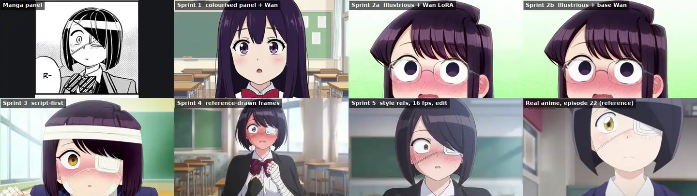

3 s · alignment confidence 1.00 · line: “R—” · <a href="https://solvai.github.io/MangAnime/eval/#sample-01">play as video</a>

Sprints 1 and 2 draw the wrong girl: the panel-by-panel reader did not know who was in the panel. From sprint 3 on the character is right (eyepatch, bob). Sprint 5 frames her as the close-up the show uses.

### 2. Chapter 114: Katai stands in the doorway, enormous and scowling, students shrinking back

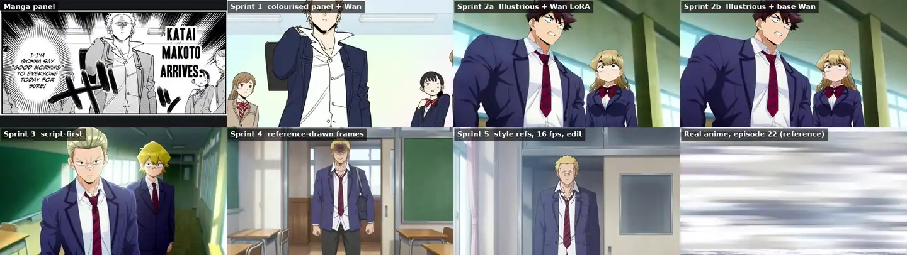

6 s · alignment confidence 0.97 · line: “I'm gonna say 'good morning' to everyone today for sure!” · <a href="https://solvai.github.io/MangAnime/eval/#sample-02">play as video</a>

Sprint 1 keeps the manga layout almost unchanged. Sprints 4 and 5 hold the cast and the room from the shots before. The real shot carries the show's name lettering, which the pipeline does not draw.

### 3. Chapter 114: Tadano turns in his seat and smiles easily at Katai, whose back fills the foreground

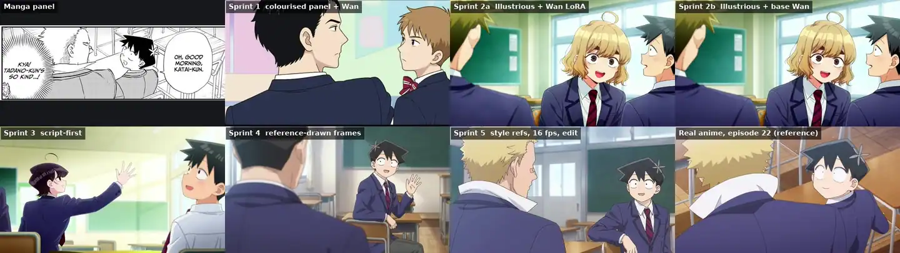

6 s · alignment confidence 0.98 · line: “Oh, good morning, Katai-kun.” · <a href="https://solvai.github.io/MangAnime/eval/#sample-03">play as video</a>

Sprint 5 looks past Katai's shoulder at Tadano, close to how the real shot is staged; earlier sprints put both side by side.

### 4. Chapter 114: Tadano gives a small, reassuring nod and a gentle smile

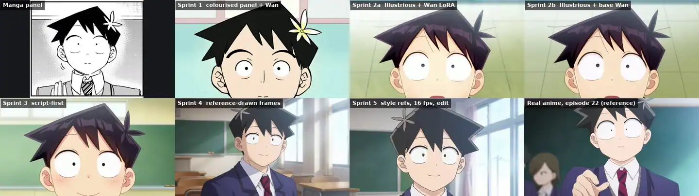

3 s · alignment confidence 1.00 · <a href="https://solvai.github.io/MangAnime/eval/#sample-04">play as video</a>

Sprint 4 drew this close-up as a boy at a desk in a wide classroom: the painter frames everything a size too wide. Sprint 5 crops finished frames to shot sizes measured on the show.

### 5. Chapter 116: Komi hides behind her raised notebook while Onemine smiles at her from the right

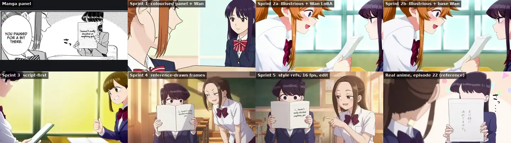

4.38 s · alignment confidence 1.00 · line: “You paused for a bit there.” · <a href="https://solvai.github.io/MangAnime/eval/#sample-05">play as video</a>

The notebook is Komi's voice. Sprints 4 and 5 write it in English inside the frame, as the pipeline's language is English throughout; the real episode writes Japanese.

### 6. Chapter 116: Otori leans in with clasped hands as Onemine turns to her with a warm grin, Komi watching

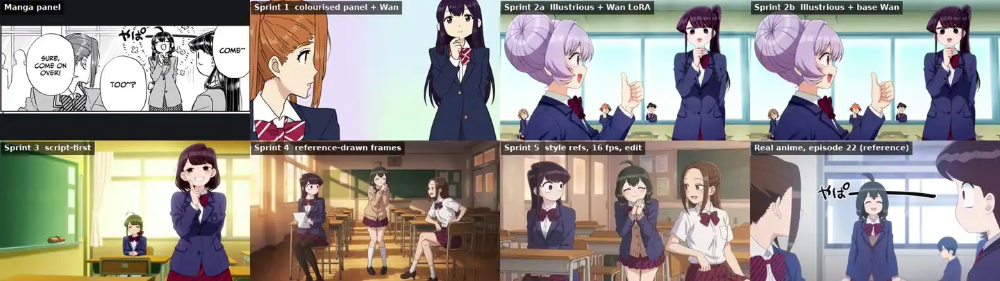

6 s · alignment confidence 0.84 · line: “Can I~ come too~?” · <a href="https://solvai.github.io/MangAnime/eval/#sample-06">play as video</a>

Three girls, and until sprint 3 at least one of them is someone else. Sprint 4's reference-drawn frames get all three right and keep their clothes from shot to shot.

### 7. Chapter 117: Najimi bursts through the classroom door with both arms flung wide, scarf flying

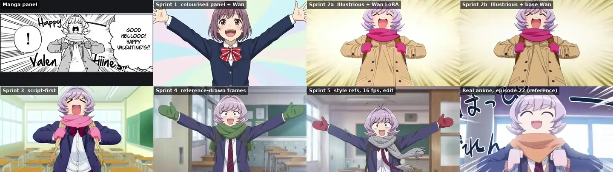

4.05 s · alignment confidence 0.90 · line: “Hello! Happy Valentine's!” · <a href="https://solvai.github.io/MangAnime/eval/#sample-07">play as video</a>

The header image of the repository. Every sprint understood the entrance; the look moves from flat manga colouring to the show's palette. The real shot adds motion lettering.

### 8. Chapter 117: Komi offers a chocolate bag and Yadano takes it with both trembling hands

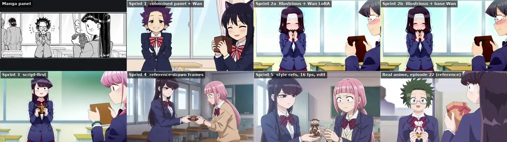

4 s · alignment confidence 0.81 · <a href="https://solvai.github.io/MangAnime/eval/#sample-08">play as video</a>

The least certain alignment of the twelve (confidence 0.81): the generated shots and the real one may be neighbouring beats of the same hand-over, and the recipient differs.

### 9. Chapter 117: Katai stands over the desk, flushed crimson, one hand still on the chocolate ribbon

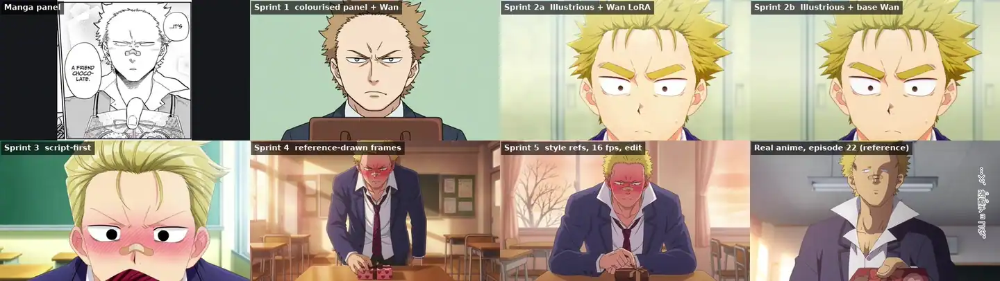

4.25 s · alignment confidence 0.95 · line: “...It's a friend chocolate.” · <a href="https://solvai.github.io/MangAnime/eval/#sample-09">play as video</a>

Sprints 4 and 5 put the scene in an evening classroom and keep Katai on model, but give him a necktie the show never does: a costume error sprint 6 reads off the show's own character picture.

### 10. Chapter 118: Two empty swings hang side by side in a small park at dusk, bare winter trees behind them

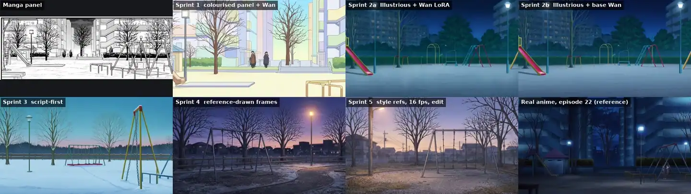

3 s · alignment confidence 0.98 · <a href="https://solvai.github.io/MangAnime/eval/#sample-10">play as video</a>

An empty set. Sprint 1 colours the panel as a bright day; from sprint 4 on the frame follows the script's dusk. The real episode plays the scene later at night.

### 11. Chapter 118: Komi looks down bashfully beside Tadano's wide, astonished eyes in a split close-up

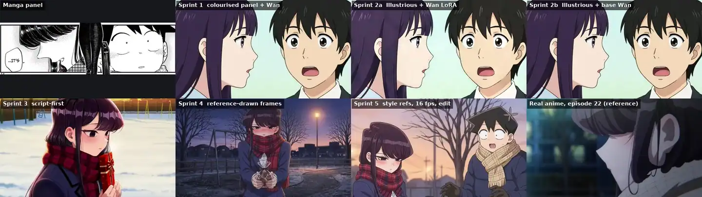

5.09 s · alignment confidence 0.85 · line: “...It's... it's a friend chocolate...” · <a href="https://solvai.github.io/MangAnime/eval/#sample-11">play as video</a>

The manga's split close-up. Sprints 1 to 2 keep the split; sprint 5 restages it as a two-shot with the scarves the script gave them. The real shot is an extreme close-up in near darkness.

### 12. Chapter 118: Tadano stands stiff on the path, gripping the railing, mouth open in a cracked reply

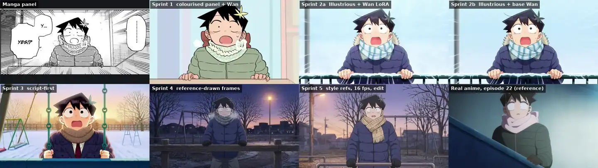

4 s · alignment confidence 0.99 · line: “Y... yes!?” · <a href="https://solvai.github.io/MangAnime/eval/#sample-12">play as video</a>

A reaction shot. Motion is the difference between sprints 4 and 5 here: the earlier clips were played at 8 drawings a second, sprint 5 at 16.

## What blind raters said

Two independent blind raters (AI models that saw only unlabelled pairs, order randomised) compared 40 frames and 40 clips of
the generated episode with the real one, for sprint 4 and again for sprint 5. They recognised the generated side every
time. What changed between the sprints is why.

**Sprint 4**, the cues both raters listed: clips barely move; over-detailed, sharp backgrounds; glossy shading; stock
English lettering; a mouth that moves on a silent "……".

**Sprint 5**, by the raters' own counts over 80 judgements each:

| What gave the generated side away | Rater A | Rater B |
|---|---|---|
| Stock sets: a pale classroom with a wall clock instead of the show's room | ≈ 40 | ≈ 55 |
| Costume or design details unlike the show's | ≈ 30 | ≈ 35 |
| Flat, frontal staging; no over-the-shoulder views, no foregrounds | ≈ 20 | ≈ 30 |
| No on-screen caption boxes or lettering | ≈ 20 | ≈ 25 |
| Heavier outline, more rendering than the show | ≈ 25 | ≈ 12 |
| Temporal defects in clips (drifting hair, a hand or bag changing) | ≈ 15 | ≈ 6 |

"Clips barely move" is gone from both lists.

## Sprint 6 (in progress)

Three changes, each tested on about 24 frames with a blind rater before a full episode is rendered.

| Change | Test | Result |
|---|---|---|
| Real frames of the school's rooms (training episodes only) as set references, plus a written set note | 25 school shots, old frame against new | new closer to the show in 18 of 23 decided pairs |
| The above, uniforms as worn in the show's own character pictures, and a camera pass | 24 shots of four scenes | new closer in 21 of 23; more show-like camera in 17 of 21; drawing errors noticed: 0 new, 7 old |

The camera pass exists because of this measurement, made with one labeller on both sides:

| How the main person is seen | The show (588 training frames) | Sprint 5 as drawn | Sprint 6 plan |
|---|---|---|---|
| frontal | 33 % | 45 % | 35 % |
| three-quarter | 22 % | 39 % | 24 % |
| profile | 22 % | 12 % | 19 % |
| from behind | 15 % | 3 % | 12 % |
| over the shoulder | 9 % | 1 % | 10 % |
| camera not at eye level | 35 % | 11 % | 36 % |

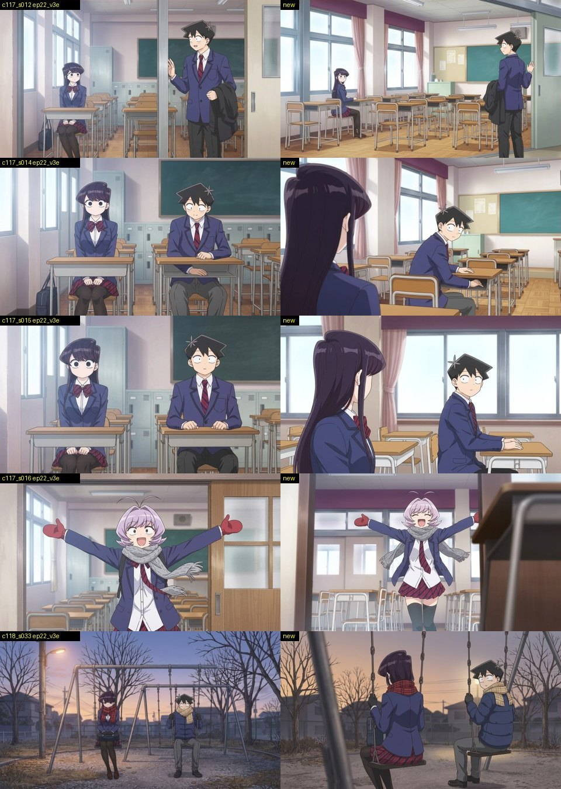

Left: sprint 5. Right: the same shot with set references, corrected uniforms and a staged camera.

## Caveats

- One series, one held-out episode, one generated episode per sprint. Differences of a few points are not findings.
- The raters are models. The one human rating is six pairs by the author.
- FVD and the frame distance reward resemblance to the real episode's *distribution*; they do not see whether a scene is
  staged well. Sprint 4 is the example: it holds scenes far better than sprint 3 and scores worse on both.
- The twelve samples were chosen for clear correspondence between sprints and the real shot. Shots that the pipeline
  invented, dropped or merged cannot appear in such a comparison.
- The real episode is used for evaluation only, and only short silent excerpts of it are shown here.
